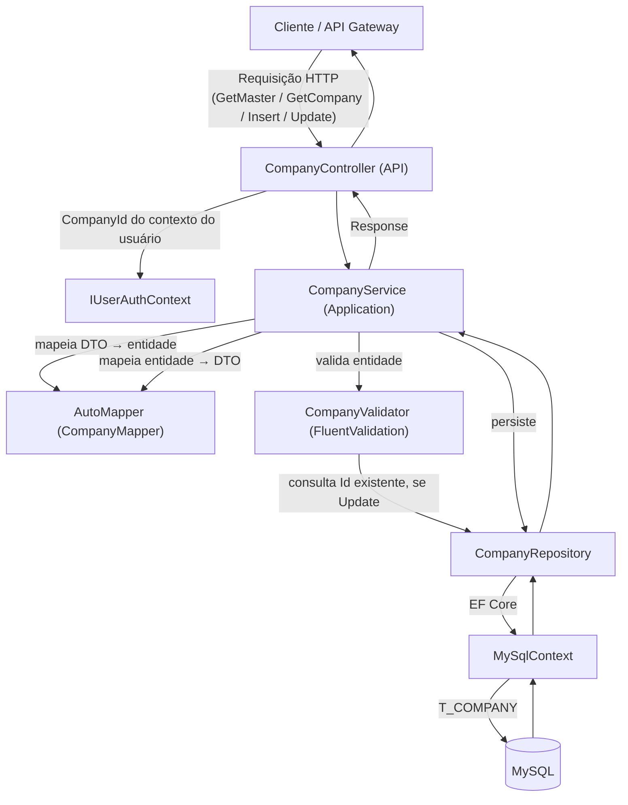
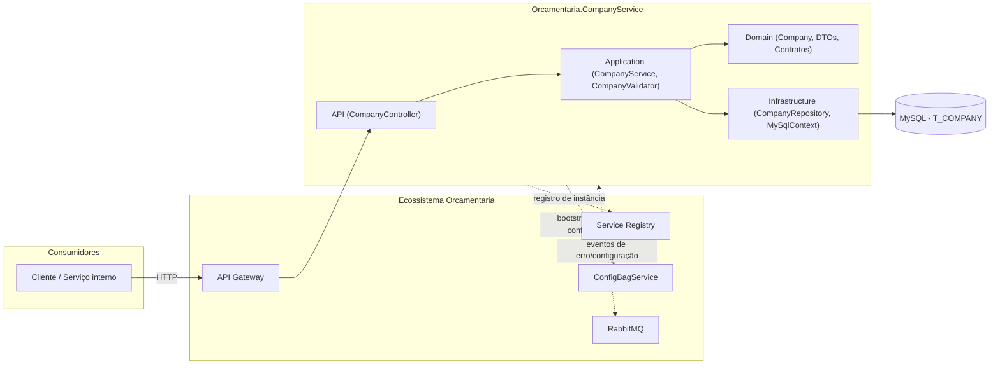
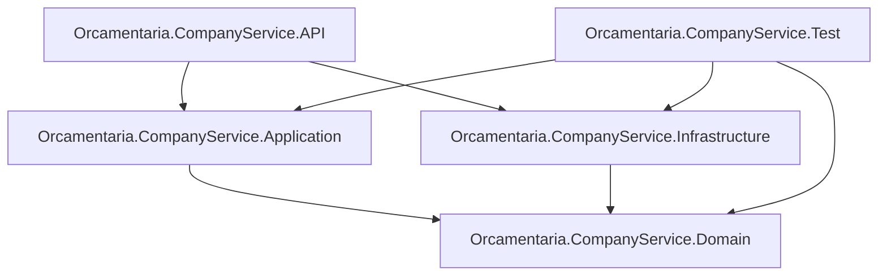

# 🏢 Orcamentaria.CompanyService

Microsserviço do ecossistema **Orcamentaria** responsável pelo cadastro e manutenção das **empresas (Companies)** que utilizam a plataforma — o registro central de tenants sobre o qual os demais serviços do ecossistema se apoiam para segmentar dados por `CompanyId`.

---

## 🎯 Objetivo

O `Orcamentaria.CompanyService` expõe operações de CRUD sobre a entidade `Company`:

1. Cadastro de novas empresas (`Insert`), restrito a usuários com papel `MASTER`;
2. Consulta paginada de todas as empresas cadastradas (`GetMaster`), restrita a `MASTER`;
3. Consulta da empresa do próprio usuário autenticado (`GetCompany`);
4. Atualização da própria empresa pelo usuário autenticado, ou de qualquer empresa por um `MASTER` (`Update`).

Cada empresa possui dados cadastrais (razão social, nome fantasia, CNPJ, endereço, telefones, e-mail) e um indicador de atividade (`Active`), além de trilhas de auditoria (`CreatedAt`/`CreatedBy`/`UpdatedAt`/`UpdatedBy`).

---

## 🧰 Tecnologias

| Tecnologia | Versão | Finalidade |
|---|---|---|
| C# / .NET | 9 | Linguagem e runtime da aplicação |
| ASP.NET Core Web API | `Microsoft.NET.Sdk.Web` | Hospedagem HTTP |
| Entity Framework Core | 9.0.11 | ORM de acesso a dados |
| MySql.EntityFrameworkCore | 9.0.9 | Provider EF Core para MySQL |
| AutoMapper | 16.2.0 | Mapeamento entre `Company` (entidade) e DTOs |
| FluentValidation | 12.1.0 | Validação da entidade `Company` antes de inserir/atualizar |
| Microsoft.OpenApi | 3.8.0 | Suporte a geração de documentação Swagger/OpenAPI |
| `Orcamentaria.Lib.Domain` | 10.1.1 | Modelos, enums, exceptions e contratos compartilhados do ecossistema |
| `Orcamentaria.Lib.Application` | 2.1.4 | Implementações compartilhadas de HTTP client, Service Registry, cache e providers |
| `Orcamentaria.Lib.Infrastructure` | 5.4.0 | Composição de serviços, repositório base e middlewares comuns a todos os serviços |
| `Orcamentaria.Lib.Test` | 1.1.3 | Fixtures e casos de teste genéricos reutilizados nos testes do serviço |
| xUnit / coverlet.collector | 2.9.2 / 6.0.2 | Stack de testes unitários (`Orcamentaria.CompanyService.Test`) |

---

## 🏗️ Arquitetura

O projeto segue uma **arquitetura em camadas**, apoiada na biblioteca interna compartilhada `Orcamentaria.Lib`, que concentra a infraestrutura transversal do ecossistema (autenticação, Swagger, CORS, mensageria, repositório base, configuração dinâmica).

- **Domain**: entidade `Company`, DTOs (`CompanyInsertDTO`, `CompanyUpdateDTO`, `CompanyResponseDTO`), perfil de mapeamento AutoMapper (`CompanyMapper`) e os contratos `ICompanyRepository<TEntity>` / `ICompanyService`.
- **Application**: `CompanyService` (regra de negócio/orquestração) e `CompanyValidator` (regras de validação com FluentValidation).
- **Infrastructure**: `MySqlContext` (DbContext do EF Core), `CompanyConfiguration` (mapeamento fluente da tabela `T_COMPANY`) e `CompanyRepository`, que estende o `BaseRepository<TEntity>` de `Orcamentaria.Lib.Infrastructure`.
- **API**: `CompanyController`, composição de injeção de dependência (`Startup.cs`) e chaves públicas RSA para validação de token.
- **Test**: testes unitários de serviço, validador e repositório, usando fixtures e casos de teste genéricos de `Orcamentaria.Lib.Test`.

Fluxo de dependência entre camadas: `API → Application/Infrastructure → Domain`, sempre apontando para dentro.

---

## 📁 Estrutura do Projeto

```text
Orcamentaria.CompanyService/
├── Orcamentaria.CompanyService.API/                # Apresentação HTTP (composition root)
│   ├── Controllers/v1/CompanyController.cs         #   Endpoints de Company
│   ├── Keys/                                       #   Chaves públicas para validação de token (embedded resources)
│   ├── Program.cs / Startup.cs                     #   Bootstrap e injeção de dependências
│   └── appsettings*.json                           #   Configuração local da aplicação
├── Orcamentaria.CompanyService.Application/        # Regras de negócio
│   ├── Services/CompanyService.cs                  #   Orquestra validação, mapeamento e persistência
│   └── Validators/CompanyValidator.cs              #   Regras de validação (FluentValidation)
├── Orcamentaria.CompanyService.Domain/              # Contratos, entidade e DTOs
│   ├── DTOs/Company/CompanyInsertDTO.cs, CompanyUpdateDTO.cs, CompanyResponseDTO.cs
│   ├── Mappers/CompanyMapper.cs
│   ├── Models/Company.cs
│   ├── Repositories/ICompanyRepository.cs
│   └── Services/ICompanyService.cs
├── Orcamentaria.CompanyService.Infrastructure/     # Acesso a dados
│   ├── Configurations/CompanyConfiguration.cs      #   Mapeamento EF Core (tabela T_COMPANY)
│   ├── Contexts/MySqlContext.cs                    #   DbContext
│   └── Repositories/CompanyRepository.cs           #   Implementação sobre BaseRepository<Company>
├── Orcamentaria.CompanyService.Test/                # Testes unitários (xUnit)
│   ├── Contexts/MySqlContextTest.cs
│   ├── Fixtures/CompanyFixture.cs
│   ├── Repositories/CompanyRepositoryTest.cs
│   ├── Services/CompanyServiceTest.cs
│   └── Validators/CompanyValidatorTest.cs
├── Dockerfile
├── compose.yaml
└── Orcamentaria.CompanyService.sln
```

---

## 🔄 Fluxo da Aplicação



**Passo a passo (exemplo: `Insert`):**
1. O cliente envia `POST /api/v1/Company/Insert` com um `CompanyInsertDTO`, autenticado com papel `MASTER`.
2. `CompanyController` delega a chamada a `ICompanyService.InsertAsync`.
3. `CompanyService` mapeia o DTO para a entidade `Company` via AutoMapper.
4. `CompanyValidator.ValidateBeforeInsert` valida os campos obrigatórios, tamanhos máximos, formato de CNPJ/e-mail e garante que `Id` não tenha sido informado.
5. Se válido, `CompanyRepository.InsertAsync` persiste a entidade via `MySqlContext` (preenchendo automaticamente `CreatedAt`/`CreatedBy`/`UpdatedAt`/`UpdatedBy` na base, conforme comportamento do `BaseRepository`).
6. A entidade persistida é mapeada de volta para `CompanyResponseDTO` e retornada dentro de um `Response<CompanyResponseDTO>`.

---

## 📦 Dependências principais

| Biblioteca | Uso no projeto |
|---|---|
| `Orcamentaria.Lib.Domain` | Modelos compartilhados: `Response<T>`, `ResponsePagination`, `GridParams`, `IUserAuthContext`, exceptions de domínio (`InfoException`, `ValidationException`, `UnexpectedException`, `NotFoundException`, `DatabaseException`). |
| `Orcamentaria.Lib.Application` | `HttpClientService`, `ServiceRegistryService`, `ApiGetawayService`, `RabbitMqPublishService`, `RsaService`, providers de token. |
| `Orcamentaria.Lib.Infrastructure` | `ResolveConfigs`/`ResolveCommonServicesWithMySql`/`ConfigureCommon`, usados em `Startup.cs`; `BaseRepository<TEntity>`, herdado por `CompanyRepository` para operações de CRUD, paginação e filtros; middlewares comuns (autenticação, tratamento de erros, request). |
| `Orcamentaria.Lib.Test` | `BaseFixture<TEntity>` (base de `CompanyFixture`, com Bogus para geração de dados fake) e casos de teste genéricos de repositório (`ReadWithoutCompanyRepositoryTests`, `WriteWithCompanyRepositoryTests`). |

---

## ⚙️ Configuração

A aplicação usa o modelo padrão de configuração do ASP.NET Core (`appsettings.json` + `appsettings.{Environment}.json` + variáveis de ambiente), combinado com um mecanismo de **configuração centralizada dinâmica**:

Ao subir, `Startup.ConfigureServices` chama `services.ResolveConfigs(...)`, que usa `ApiGetawayConfiguration.BaseUrl` e um segredo de bootstrap (`BOOTSTRAPSECRET`) para obter um token de bootstrap junto ao API Gateway e, em seguida, buscar no **ConfigBagService** (via roteamento do Gateway) o pacote de configurações do serviço `Orcamentaria.CompanyService` — incluindo `ConnectionStrings` (ex.: `DefaultConnection` do MySQL), `ServiceRegistryConfiguration`, `ServiceConfiguration` e `MessageBrokerConfiguration`. Essas configurações são mescladas em memória ao `IConfiguration` da aplicação antes do restante do pipeline de DI ser resolvido.

**`Orcamentaria.CompanyService.API/appsettings.json`** (apenas o necessário para o bootstrap local):
```json
{
  "Logging": {
    "LogLevel": {
      "Default": "Information",
      "Microsoft.AspNetCore": "Warning"
    }
  },
  "ApiGetawayConfiguration": {
    "BaseUrl": "https://localhost:44385"
  },
  "BOOTSTRAPSECRET": "<segredo de bootstrap>"
}
```

**`Orcamentaria.CompanyService.API/appsettings.Development.json`:** contém apenas overrides de `Logging` para o ambiente de desenvolvimento.

- **`ApiGetawayConfiguration.BaseUrl`**: endereço do API Gateway usado para obter o token de bootstrap e rotear a consulta ao ConfigBagService.
- **`BOOTSTRAPSECRET`**: segredo usado para emissão do token de bootstrap durante a inicialização (seu valor real não é reproduzido neste documento).

---

## 🔑 Variáveis de Ambiente

| Variável | Descrição |
|---|---|
| `ASPNETCORE_ENVIRONMENT` | Define o ambiente ASP.NET Core (default `Development` via `launchSettings.json`). |
| `ApiGetawayConfiguration__BaseUrl` | URL do API Gateway usada na inicialização para obter o token de bootstrap e as configurações centralizadas (default `https://localhost:44385`). |
| `BOOTSTRAPSECRET` | Segredo de bootstrap usado para autenticação inicial junto ao ecossistema. |
| `ConnectionStrings__DefaultConnection` | String de conexão com o MySQL, usada no `compose.yaml` como baseline local (a configuração efetiva pode ser sobreposta pelo pacote retornado pelo ConfigBagService). |
| `ASPNETCORE_URLS` | Endereço/porta em que o Kestrel escuta (usado em `compose.yaml`, ex. `http://+:5000`). |

---

## 🗄️ Banco de Dados

O serviço usa **MySQL**, acessado via Entity Framework Core (`Microsoft.EntityFrameworkCore` + `MySql.EntityFrameworkCore`), configurado em `MySqlContext` com `options.UseMySQL(configuration.GetConnectionString("DefaultConnection"))`.

**Tabela `T_COMPANY`** (mapeada em `CompanyConfiguration`):

| Coluna | Tipo | Observação |
|---|---|---|
| `ID` | `BIGINT` | Chave primária, auto-incremento |
| `CORPORATE_NAME` | `VARCHAR(90)` | Obrigatório |
| `TRADE_NAME` | `VARCHAR(120)` | Obrigatório |
| `CNPJ` | `CHAR(14)` | Obrigatório |
| `ADDRESS` | `VARCHAR(150)` | Opcional |
| `TELEPHONE` | `VARCHAR(25)` | Opcional |
| `CELLPHONE` | `VARCHAR(25)` | Opcional |
| `EMAIL` | `VARCHAR(100)` | Opcional |
| `ACTIVE` | `BIT` | Default `true` |
| `CREATED_AT` / `CREATED_BY` | `DATETIME` / `BIGINT` | Preenchidos automaticamente pelo `BaseRepository` na inserção |
| `UPDATED_AT` / `UPDATED_BY` | `DATETIME` / `BIGINT` | Preenchidos automaticamente pelo `BaseRepository` na atualização |

O `compose.yaml` também sobe um container MySQL local (`mysql:8.0`) para desenvolvimento, expondo a porta `4406` e criando o banco/usuário de exemplo usado pelo serviço em ambiente containerizado.

---

## Configuração local

Nenhum valor real deve existir nos arquivos versionados. Configure via `dotnet user-secrets` ou variáveis de ambiente:

```bash
dotnet user-secrets init --project Orcamentaria.CompanyService.API
dotnet user-secrets set "BOOTSTRAPSECRET" "<valor-do-bootstrapsecret>" --project Orcamentaria.CompanyService.API
dotnet user-secrets set "ConnectionStrings:DefaultConnection" "Server=localhost;Port=3306;Database=company;User=<user>;Password=<senha>;SslMode=Disabled" --project Orcamentaria.CompanyService.API
```

Ou crie `Orcamentaria.CompanyService.API/appsettings.Development.json` (já ignorado pelo `.gitignore`) com os valores locais. Nunca commite esse arquivo.

---

## ▶️ Como Executar

### Pré-requisitos
- [.NET SDK 9.0](https://dotnet.microsoft.com/download)
- Instância MySQL acessível
- API Gateway em execução e acessível em `ApiGetawayConfiguration:BaseUrl`
- ConfigBagService e Service Registry em execução (dependências da inicialização do serviço)

### Local

```bash
git clone <url-do-repositorio>
cd Orcamentaria.CompanyService

dotnet restore
dotnet build

dotnet run --project Orcamentaria.CompanyService.API
```

O perfil padrão (`launchSettings.json`) sobe a API em `https://localhost:53092` (HTTP em `http://localhost:53093`), abrindo automaticamente o navegador.

### Via Docker / Docker Compose

O repositório contém um `Dockerfile` (multi-stage: build/publish com SDK do .NET e execução com a imagem `aspnet`) e um `compose.yaml` que orquestra o serviço junto de um container MySQL:

```bash
docker compose up --build
```

Isso sobe:
- `mysql`: MySQL 8.0, exposto em `localhost:4406`;
- `CompanyService-a`: a API do `Orcamentaria.CompanyService`, exposta em `localhost:5000`, com `ConnectionStrings__DefaultConnection` apontando para o container MySQL do compose.

---

## 🧪 Como Rodar Testes

O projeto de testes (`Orcamentaria.CompanyService.Test`) usa **xUnit** e utilitários de `Orcamentaria.Lib.Test` (fixtures com Bogus e casos de teste genéricos de repositório).

```bash
dotnet test
```

Para gerar relatório de cobertura:

```bash
dotnet test --collect:"XPlat Code Coverage"
```

**Cobertura por classe testada:**

| Classe testada | Cenários cobertos |
|---|---|
| `CompanyService` | busca por id (sucesso e não encontrado), listagem paginada (sucesso e vazia), inserção (sucesso e corpo inválido), atualização (sucesso e exceção inesperada) |
| `CompanyValidator` | validações de campo obrigatório, tamanho máximo, formato de CNPJ e e-mail, regras específicas de inserção (Id não informado) e atualização (Id obrigatório e existente) |
| `CompanyRepository` | casos de leitura e escrita herdados dos testes genéricos `ReadWithoutCompanyRepositoryTests`/`WriteWithCompanyRepositoryTests` de `Orcamentaria.Lib.Test`, usando `CompanyFixture` e `MySqlContextTest` |

---

## 🧭 APIs

### Swagger / OpenAPI
Habilitado em ambiente de desenvolvimento, acessível em `/swagger`. O acesso ao `swagger.json` é protegido por headers `ClientId`/`ClientSecret` validados contra `ServiceConfiguration`.

### Endpoints (`api/v1/Company`)

| Método | Rota | Nome | Roles | Descrição |
|---|---|---|---|---|
| `GET` | `/api/v1/Company/GetMaster` | `CompanyGetOnlyMaster` | `MASTER` | Lista paginada de todas as empresas (`GridParams`), retorna `Response<IEnumerable<CompanyResponseDTO>>`. |
| `GET` | `/api/v1/Company/GetCompany` | `CompanyGetById` | `MASTER`, `COMPANY_MASTER`, `COMPANY:READ` | Retorna os dados da empresa do usuário autenticado (`_userAuthContext.CompanyId`). |
| `POST` | `/api/v1/Company/Insert` | `CompanyInsertOnlyMaster` | `MASTER` | Cadastra uma nova empresa a partir de `CompanyInsertDTO`. |
| `GET` | `/api/v1/Company/Update` | `CompanyUpdate` | `MASTER`, `COMPANY_MASTER`, `COMPANY:UPDATE` | Atualiza a empresa do usuário autenticado a partir de `CompanyUpdateDTO`. |
| `GET` | `/api/v1/Company/Update/{id}` | `CompanyUpdateOnlyMaster` | `MASTER` | Atualiza a empresa de `id` informado a partir de `CompanyUpdateDTO`. |

---

## 🔗 Integrações

| Integração | Descrição |
|---|---|
| **API Gateway** | Ponto de entrada para chamadas ao serviço; também usado na inicialização para obter o token de bootstrap e rotear a consulta de configuração. |
| **ConfigBagService** | Fonte da configuração centralizada do serviço (connection strings, Service Registry, mensageria), consultada via `ConfigurationBagGetByServiceName` durante o bootstrap. |
| **Service Registry** | O serviço se registra como instância disponível via `AddServiceRegistryHosted`, permitindo que o API Gateway o descubra. |
| **RabbitMQ** | Infraestrutura compartilhada de `Orcamentaria.Lib` usada para publicação de eventos de erro/log e recebimento de atualizações de configuração em tempo real. |

---

## 📈 Logs

Logging via `Microsoft.Extensions.Logging`, configurado em `appsettings.json`:

```json
"Logging": {
  "LogLevel": {
    "Default": "Information",
    "Microsoft.AspNetCore": "Warning"
  }
}
```

Exceções de negócio capturadas pelo `ErrorHandlingMiddleware` são registradas via `ILogService`, junto com o contexto da requisição de origem (host, rota, método, corpo, query e route values).

---

## 🚨 Tratamento de Erros

O `CompanyController` propaga as exceções lançadas por `CompanyService` (`InfoException`, `ValidationException`, `UnexpectedException`) para o `ErrorHandlingMiddleware` compartilhado, que:
- Loga a exceção junto com o contexto da requisição de origem;
- Responde em JSON no formato `Response<dynamic>`, com o `StatusCode` HTTP correspondente ao `ErrorCode` da exceção;
- Suporta múltiplas mensagens de erro por exceção (separadas por `" || "`), como ocorre nas falhas de validação do FluentValidation.

---

## 🔐 Segurança

O serviço participa da infraestrutura de autenticação do ecossistema baseada em **JWT (RS256)**, com validação por meio de chaves públicas RSA embarcadas (`Keys/public_key_user.pem`, `Keys/public_key_service.pem`). Os endpoints do `CompanyController` são protegidos com `[Authorize(Roles = "...")]`, distinguindo entre:
- `MASTER`: acesso irrestrito a qualquer empresa (listar todas, cadastrar, atualizar qualquer uma);
- `COMPANY_MASTER` / `COMPANY:READ` / `COMPANY:UPDATE`: acesso restrito à própria empresa, identificada por `IUserAuthContext.CompanyId`.

O acesso ao `swagger.json` é adicionalmente protegido por headers `ClientId`/`ClientSecret` validados contra `ServiceConfiguration`.

---

## 🧩 Padrões Encontrados

| Padrão | Onde aparece |
|---|---|
| **Repository** | `ICompanyRepository<TEntity>` / `CompanyRepository`, estendendo o `BaseRepository<TEntity>` genérico da biblioteca compartilhada. |
| **Dependency Injection** | Serviços, validadores, repositórios e mapeadores registrados via `IServiceCollection` e injetados por construtor. |
| **DTO** | `CompanyInsertDTO`, `CompanyUpdateDTO`, `CompanyResponseDTO` como contratos de entrada/saída da API, desacoplados da entidade `Company`. |
| **Object Mapper** | `CompanyMapper` (perfil AutoMapper) para conversão entre `Company` e os DTOs. |
| **Fluent Validation** | `CompanyValidator` implementando `IValidatorEntity<Company>`, com regras comuns reaproveitadas entre inserção e atualização. |
| **Interface Segregation** | Contratos (`ICompanyRepository`, `ICompanyService`) definidos em Domain, implementados em Application/Infrastructure. |

---

## 📊 Diagrama de Arquitetura



---

## 🧱 Dependências entre Módulos



---

## 📝 Resumo Executivo

O **Orcamentaria.CompanyService** é o microsserviço responsável pelo cadastro das empresas (tenants) do ecossistema Orcamentaria, construído em .NET 9 com ASP.NET Core Web API e persistência em MySQL via Entity Framework Core. Expõe endpoints para listar todas as empresas (`MASTER`), consultar e atualizar a própria empresa (`COMPANY_MASTER`/`COMPANY:READ`/`COMPANY:UPDATE`) e cadastrar/atualizar empresas de forma irrestrita (`MASTER`).

A solução é organizada em camadas (`API → Application/Infrastructure → Domain`), apoiada na biblioteca compartilhada `Orcamentaria.Lib`, que fornece autenticação JWT, repositório base, Swagger, CORS e o mecanismo de configuração centralizada que busca, no bootstrap, as configurações do serviço (incluindo a connection string do MySQL) junto ao ConfigBagService, por meio do API Gateway. O projeto conta com testes unitários cobrindo o serviço de aplicação, o validador de regras de negócio e o repositório de dados.
